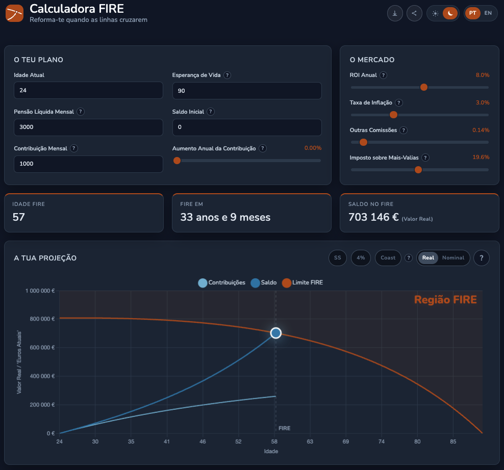

<div align="center">

# FIRE Calculator PT

**Retire when the lines cross.**
A FIRE (Financial Independence, Retire Early) calculator built for investors in Portugal.

[](https://github.com/Vitor29Narciso/fire-calculator-pt/actions/workflows/test.yml)
[](https://github.com/Vitor29Narciso/fire-calculator-pt/stargazers)
[](https://github.com/Vitor29Narciso/fire-calculator-pt/commits/main)


[**Live app: firecalculator.pt**](https://firecalculator.pt)

</div>



---

## Table of contents

- [Why this exists](#why-this-exists)
- [Features](#features)
- [How the model works](#how-the-model-works)
- [Quick start](#quick-start)
- [Using the app and the API](#using-the-app-and-the-api)
- [Inputs](#inputs)
- [Tech stack](#tech-stack)
- [Project layout](#project-layout)
- [Tests and CI](#tests-and-ci)
- [Deployment](#deployment)
- [Limitations](#limitations)
- [Contributing](#contributing)
- [Star history](#star-history)
- [Author and support](#author-and-support)
- [Disclaimer and privacy](#disclaimer-and-privacy)

## Why this exists

Most FIRE calculators answer the question *"how much do I need?"* with a single
rule of thumb: multiply your yearly spending by 25 (the 4% rule) and call it a
day. That is a fine starting point, but it hides things that matter a lot when
you invest from Portugal:

- **How much you need depends on how long you will live after retiring.** The
  4% rule comes from historical windows of about 30 years, and it is commonly
  applied to much longer early retirements as a "never run out" number. In
  practice that means sizing your portfolio so it keeps growing faster than you
  spend it, and most people who follow it end their lives with a large pile of
  money they never used. That is not the goal here. The optimum is to reach
  your last day with close to **0 EUR**, so the calculator sizes the portfolio
  for the number of years you actually expect to need it. Retire at 45 and you
  need money for roughly 45 years. Retire at 60 and you need it for 30. A
  fixed multiple of your spending cannot tell those two cases apart, which is
  why in many scenarios you need less than 25 times your yearly spending.
- **Tax is paid on gains, not on withdrawals.** Selling a lot that has barely
  grown costs almost nothing in capital gains tax, while selling an old lot with
  large gains costs much more. A flat withdrawal rate ignores this entirely.
- **Inflation changes everything over decades.** A flat 1,000 EUR monthly
  transfer buys less every year unless you raise it. The calculator treats this
  explicitly instead of quietly assuming contributions track inflation.
- **The state pension is a moving finish line.** The Portuguese legal retirement
  age is not 65 and it changes over time, so it is shown as a reference marker
  on the chart.

These effects pull in opposite directions. Planning to finish at zero lowers the
capital you need, while capital gains tax and inflation raise it, and many
calculators leave both of those out. Putting all of them in the same model is
the point: the answer you get is the net result for your own numbers.

This project started as a Google Sheets prototype and grew into a small web app
with a proper model behind it. The goal is simple: give people a calculator that
is honest about its assumptions, models taxes the way they actually work for
Portuguese investors, and is open source so everyone can check the maths,
provide feedback and contribute to improve it.

## Features

- **Horizon-aware required capital.** The portfolio is sized to run down to
  about zero at your life expectancy, instead of lasting forever, so retiring
  earlier or later changes the amount you need.
- **FIFO lot-by-lot drawdown model.** Individual purchase lots are tracked and
  sold oldest-first, taxing only the realised gain of each lot.
- **FIRE age, to the month.** The earliest month at which your portfolio can
  fund your target income until life expectancy.
- **Interactive chart** with contributions, balance and the FIRE threshold, plus
  a shaded FIRE region once the lines cross.
- **Comparison overlays**
  - **4%**: the classic 25x rule of thumb, for comparison.
  - **Coast**: Coast FIRE, the point where you can stop investing and still
    reach FIRE at the legal retirement age.
  - **SS**: the Portuguese Social Security legal retirement age, as a marker.
- **Real / Nominal toggle.** See everything in today's euros or in each year's
  euros as it would appear on an account statement.
- **Year-by-year table** with a compact summary view and a full view.
- **Shareable simulations.** One click creates a short link (`/s/xxxxxxxx`) and
  share buttons for WhatsApp, Messenger, Telegram and email.
- **PDF report** of your simulation, rendered identically on desktop and mobile.
- **English and Portuguese**, detected from the browser and switchable at any
  time.
- **Day and night themes**, following the system by default.
- **Responsive**, with a mobile layout and touch-friendly chart tooltips.
- **No account, no tracking cookies, no build step** for the front end.

## How the model works

Everything is modelled in **today's euros**, except the contribution schedule.

- `monthly_contribution` is this year's standing order. Each birthday it is
  raised nominally by `contribution_growth_rate` (default 0%), then deflated by
  inflation. A flat 1,000 EUR transfer therefore loses purchasing power as
  prices rise.
- Retirement spending stays in today's purchasing power.
- The portfolio compounds at a Fisher real return:

  ```
  real_return = (1 + roi) / (1 + inflation) / (1 + fee) - 1
  ```

- **Accumulation** projects the portfolio month by month while you contribute.
- **Drawdown** simulates retirement year by year. Each year the portfolio earns
  its return, then enough lots are sold, oldest first (**FIFO**), to deliver the
  target net income after capital gains tax on the realised gains.
- **Required capital** for each possible retirement age is found by bisection:
  the smallest starting balance for which the drawdown simulation lasts until
  life expectancy.
- **FIRE age** is the earliest month where the projected balance reaches the
  required capital.

Early retirement years sell low-gain lots and pay less tax, which lowers the
capital actually required compared to the 4% rule of thumb.

### Why the horizon matters

The required capital is computed separately for every retirement age, because
the number of years you have to fund changes with it. The 4% rule uses one
fixed multiple of 25 for all of them. With a constant real return, the capital
needed to pay out 1 EUR a year for *N* years is:

```
capital = (1 - (1 + r)^-N) / r
```

As an illustration with a 4% real return and no tax, as a multiple of yearly
spending:

| Years to fund | Capital needed |
| ------------- | -------------- |
| 30            | about 17.3x    |
| 40            | about 19.8x    |
| 50            | about 21.5x    |
| 60            | about 22.6x    |
| Forever       | 25x            |

The 25x of the 4% rule is only reached when the money has to last forever. This
is an illustration of the principle, not what the app computes: the real model
also includes capital gains tax on each lot and your own return and inflation
assumptions, which is why its answer can land above or below any fixed
multiple.

## Quick start

Requires **Python 3.11 or newer**. The recommended tool is
[uv](https://docs.astral.sh/uv/), because dependencies are locked in `uv.lock`.

```bash
git clone https://github.com/Vitor29Narciso/fire-calculator-pt.git
cd fire-calculator-pt
uv sync --all-extras
uv run fire-web
```

Then open <http://127.0.0.1:8000>. Auto-reload is on. Change the bind address
with the `HOST` and `PORT` environment variables, for example
`PORT=3000 uv run fire-web`.

> Run it from the repository root: the app locates `web/` by walking up from
> the package directory (or use `FIRE_WEB_DIR`).

### With Docker

```bash
docker build -t fire-calculator-pt .
docker run --rm -p 8000:8000 -v fire-data:/data fire-calculator-pt
```

The volume keeps shared simulations between runs. Then open
<http://127.0.0.1:8000>.

### With pip

Unpinned versions, so results may differ from the locked environment:

```bash
python -m venv .venv && source .venv/bin/activate
pip install -e ".[dev,web]"
fire-web
```

<details>
<summary>macOS and iCloud note</summary>

On macOS, prefer `uv sync` over an editable pip install if the project lives in
an iCloud-synced `Documents` folder. Python skips hidden `.pth` files, which is
how editable installs expose the package. This repository ships a small
`macos_pth_hook` for exactly that case.

</details>

### Extras

| Extra | Contents                                         |
| ----- | ------------------------------------------------ |
| `dev` | pytest, httpx, and fastapi so the API tests run  |
| `web` | fastapi and uvicorn for the browser app          |

After changing a dependency in `pyproject.toml`, run `uv lock` and commit the
updated `uv.lock`.

## Using the app and the API

The web app is a single page served by the same FastAPI process as the API.
The API is plain JSON, so you can use the model without the UI.

| Method | Path                           | Purpose                                         |
| ------ | ------------------------------ | ----------------------------------------------- |
| GET    | `/`                            | The one-page app                                |
| GET    | `/api/defaults`                | Default inputs, field limits, SS retirement age |
| POST   | `/api/calculate`               | Run the model against a set of inputs           |
| POST   | `/api/simulations`             | Save inputs and get a short shareable id        |
| GET    | `/api/simulations/{id}`        | Load the inputs of a saved simulation           |
| GET    | `/s/{id}`                      | Open the app preloaded with a saved simulation  |

Example:

```bash
curl -s -X POST http://127.0.0.1:8000/api/calculate \
  -H "Content-Type: application/json" \
  -d '{
    "current_age": 24,
    "life_expectancy": 90,
    "monthly_contribution": 1000,
    "initial_balance": 0,
    "annual_roi": 0.08,
    "inflation_rate": 0.03,
    "management_fee_rate": 0.0014,
    "desired_monthly_net_income": 3000,
    "gains_tax_rate": 0.196,
    "contribution_growth_rate": 0
  }'
```

The response has four top-level keys:

- `summary`: FIRE age, years and months until FIRE, balance at FIRE, real
  return, and how far FIRE is ahead of the legal retirement age.
- `four_percent_rule`: the target portfolio under the 4% rule, for comparison.
- `chart`: the series used to draw the chart.
- `table`: the year-by-year rows.

Interactive API docs are available at `/docs` while the server is running.

## Inputs

All rates are decimals, so `0.08` means 8%. Every field is validated against the
limits served by `/api/defaults`.

| Key                          | Meaning                                         | Default  |
| ---------------------------- | ----------------------------------------------- | -------- |
| `current_age`                | Age today                                       | 24       |
| `life_expectancy`            | Age the balance must last until                 | 90       |
| `monthly_contribution`       | Standing order this year, in this year's euros  | 1,000    |
| `contribution_growth_rate`   | Yearly raise of that standing order (nominal)   | 0%       |
| `initial_balance`            | Starting balance, in today's euros              | 0        |
| `annual_roi`                 | Nominal expected annual return                  | 8%       |
| `inflation_rate`             | Expected annual inflation                       | 3%       |
| `management_fee_rate`        | Annual fund or platform fee                     | 0.14%    |
| `desired_monthly_net_income` | Target monthly income after tax, today's euros  | 3,000    |
| `gains_tax_rate`             | Capital gains tax on realised gains             | 19.6%    |

Defaults live in [`constants.py`](src/fire_calculator/constants.py) and limits in
[`limits.py`](src/fire_calculator/limits.py).

## Tech stack

| Area           | Tools                                                                 |
| -------------- | --------------------------------------------------------------------- |
| Language       | Python 3.11+                                                          |
| Backend        | [FastAPI](https://fastapi.tiangolo.com/), Pydantic, Uvicorn           |
| Storage        | SQLite (shared simulations only)                                      |
| Front end      | Vanilla JavaScript, HTML and CSS, no build step                       |
| Charts         | [Chart.js](https://www.chartjs.org/)                                  |
| PDF export     | [html2pdf.js](https://ekoopmans.github.io/html2pdf.js/)               |
| Tooling        | [uv](https://docs.astral.sh/uv/), pytest, httpx                       |
| CI             | GitHub Actions                                                        |
| Hosting        | Docker on [Railway](https://railway.app/)                             |
| DNS and edge   | Cloudflare (DNS, proxy, cookieless Web Analytics)                     |

## Project layout

```
src/fire_calculator/
  types.py          Frozen dataclasses for inputs and results, with validation
  constants.py      Default inputs and Portugal-specific figures
  limits.py         Field limits shared by the API and the UI
  simulations.py    SQLite storage for shareable simulations
  math/
    lots.py           Lot and Portfolio: FIFO buys, sells, and gain tracking
    accumulation.py   Monthly contribution projection
    drawdown.py       Retirement withdrawals and required-capital bisection
    fire_age.py       Ties it together: earliest month the balance suffices
  api.py            FastAPI app and JSON serialisation
web/                Static one-page app (index.html, app.js, styles.css, locales/)
tests/              pytest suite, one module per source module
macos_pth_hook/     Helper package for iCloud-synced checkouts on macOS
Dockerfile          Production image
railway.toml        Railway build and healthcheck settings
```

Dependencies flow one way: `types` and `constants` are the base, `math` builds
on them, and `api` sits on top. Nothing in `math` imports from the layers above
it, so the model can be used and tested without any web code.

## Tests and CI

```bash
uv run pytest
```

CI runs the same suite on every push to `main` and on pull requests, using
`uv sync --locked` so a stale `uv.lock` fails the build.

## Deployment

Production runs the FastAPI app in Docker on Railway. Shared simulations need a
persistent volume for SQLite.

1. Push the repository to GitHub, with `Dockerfile` and `railway.toml` on `main`.
2. In Railway, choose **New Project, Deploy from GitHub repo** and select this
   repository. Railway builds the `Dockerfile` automatically.
3. Add a **Volume** to the service with mount path `/data`. The app stores
   simulations at `/data/simulations.db`.
4. Open the generated `*.up.railway.app` URL and check that the calculator
   loads, that sharing creates a working `/s/xxxxxxxx` link, and that the PDF
   download works.

### Custom domain

1. In the Railway service, open **Settings, Networking, Custom Domain** and add
   your domain. Make sure the target port matches the port the app listens on.
2. Railway lists the DNS records to create, usually a `CNAME` plus a `TXT`
   verification record.
3. Create them at your DNS provider. If your registrar cannot serve a `CNAME` on
   the root domain, move the nameservers to Cloudflare, which can.
4. When Railway shows the domain as verified, HTTPS is issued automatically.

With Cloudflare in front, set SSL/TLS to **Full**, turn on **Always Use HTTPS**,
and redirect `www` to the root domain with a redirect rule.

### Environment variables

| Variable             | Default                 | Purpose                                                              |
| -------------------- | ----------------------- | -------------------------------------------------------------------- |
| `PORT`               | `8000`                  | Port to listen on, set by Railway                                    |
| `HOST`               | `127.0.0.1` locally     | Bind address (the Docker image binds `0.0.0.0`)                      |
| `FIRE_SIMULATION_DB` | `/data/simulations.db`  | SQLite path, use together with a volume                              |
| `FIRE_WEB_DIR`       | auto-detected           | Directory with the static front end                                  |
| `WEB_RELOAD`         | `1` locally             | Set to `0` if you run `fire-web` in production (Docker does not use it) |

## Limitations

This is a simplified model. Read these before trusting a number.

- Portuguese Social Security income is **not** modelled. The legal retirement
  age is shown purely as a comparison marker.
- Tax is a single flat rate on realised gains. It does not cover the
  progressive-rate election, holding-period relief or PPR treatment.
- Returns are a constant real rate. There is no sequence-of-returns risk and no
  Monte Carlo simulation, so a bad early decade is not represented.
- Planning to end at zero leaves no safety margin. If you live longer than the
  life expectancy you enter, the money runs out early. The model does not
  estimate longevity risk, so choose a life expectancy you are comfortable with.
- Default parameters and tax figures can become outdated. Check them against
  current rules.

## Contributing

Issues and pull requests are welcome.

1. Fork the repository and create a branch from `main`.
2. Install with `uv sync --all-extras` and run the app with `uv run fire-web`.
3. Make your change and add or update tests next to the module you touched.
4. Run `uv run pytest` and make sure it passes.
5. Open a pull request describing what changed and why.

Bug reports are most useful with the exact inputs that produced the problem.
Because simulations can be shared, a `/s/xxxxxxxx` link is a great way to
include them.

## Star history

If this project is useful to you, a star helps others find it.

<a href="https://star-history.com/#Vitor29Narciso/fire-calculator-pt&Date">
  <picture>
    <source media="(prefers-color-scheme: dark)" srcset="https://api.star-history.com/svg?repos=Vitor29Narciso/fire-calculator-pt&type=Date&theme=dark" />
    <source media="(prefers-color-scheme: light)" srcset="https://api.star-history.com/svg?repos=Vitor29Narciso/fire-calculator-pt&type=Date" />
    
  </picture>
</a>

## Author and support

Built by **Vítor Narciso**.

- GitHub: [Vitor29Narciso](https://github.com/Vitor29Narciso)
- LinkedIn: [vitor29narciso](https://www.linkedin.com/in/vitor29narciso)
- Support the project: [Buy me a coffee](https://buymeacoffee.com/vitor29narciso)

## Disclaimer and privacy

**Not financial advice.** This tool is for educational and simulation purposes
only. All figures are illustrative projections based on your inputs and the
assumptions built into the model. They are not a recommendation to buy, sell or
hold any asset, and they are not financial, investment, tax, legal or retirement
advice. Use it at your own risk.

**Privacy.** The app does not ask for or store personal data. Theme and language
preferences stay in your browser. A shared simulation stores only the numeric
inputs under a random 8-character id, and anyone who has the link can open it.
The hosted instance may use cookieless Cloudflare Web Analytics for aggregate
traffic counts.
